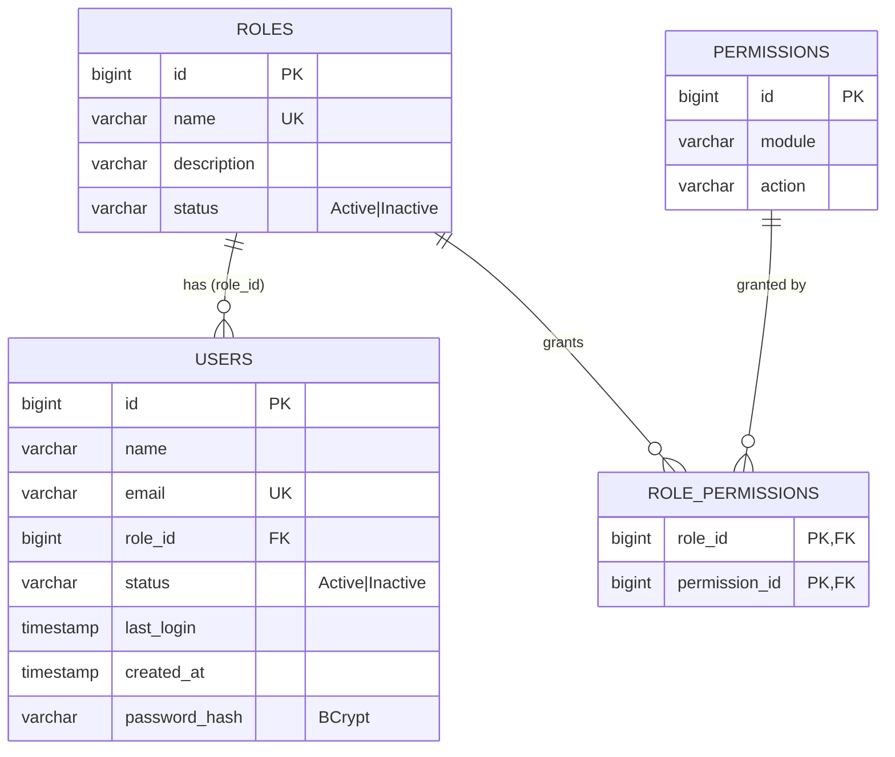

# EDABIP Users API (Task 3: Spring Data JPA + JWT)

Users, Roles and Permissions module of EDABIP (Enterprise Data Analytics & Business Intelligence Platform).
Java 17, Spring Boot 3.3, Spring Data JPA, Spring Security (stateless JWT), MySQL 8 (H2 for tests).

## Setup

1. Install JDK 17, Maven and MySQL 8.
2. Set environment variables (see `.env.example`). Nothing secret is committed.

   | Variable | Purpose | Default |
   |---|---|---|
   | `DB_URL` | JDBC url | local MySQL `edabip` (created if missing) |
   | `DB_USERNAME` / `DB_PASSWORD` | database credentials | required |
   | `JWT_SECRET` | HMAC key, at least 32 characters | required |
   | `JWT_EXPIRATION_MS` | token lifetime | `3600000` (1 hour) |
   | `CORS_ALLOWED_ORIGINS` | comma separated origins | `http://localhost:5173` |
   | `SEED_USER_PASSWORD` | password given to seeded users | `Password@123` |
   | `SPRING_PROFILES_ACTIVE` | `dev` or `test` | `dev` |

3. Run: `mvn spring-boot:run`
4. Swagger UI: http://localhost:8080/swagger-ui.html
5. Tests (H2, no MySQL needed): `mvn test`

`schema.sql` creates the tables and `data.sql` seeds them on startup. Hibernate runs with
`spring.jpa.hibernate.ddl-auto=validate`, so it only checks that entities match the schema.
Seeded users are stored with a placeholder hash; `DataInitializer` replaces it with a BCrypt hash of
`SEED_USER_PASSWORD` on first start.

Seeded logins: `alice@example.com` (ADMIN, Administrator role), `bob@example.com` (VIEWER, Viewer role).

## Authentication flow

1. `POST /auth/login` with email and password. The server checks the BCrypt hash and returns a JWT
   (`data.token`, signed HS256, contains the email as subject and the API authority in `role`).
2. The client sends `Authorization: Bearer <token>` on every request.
3. `JwtAuthFilter` validates the signature and expiry, reloads the user (so a deactivated user or a changed role takes effect
   immediately) and sets the authentication. Sessions are never created (stateless).
4. Authorization: `GET` needs `VIEWER` or `ADMIN`; `POST`, `PUT`, `PATCH`, `DELETE` need `ADMIN`.
   The business role **Administrator** maps to `ADMIN`; every other role maps to `VIEWER`.
5. Missing or invalid token gives **401**, a VIEWER writing gives **403**, both in the standard JSON format:
   `{"success": false, "message": "...", "errors": [...], "timestamp": "..."}`.

`POST /auth/register` is public and always creates a **Viewer**; an ADMIN creates admins through `POST /users`.

### Log in through Swagger
1. Open `/swagger-ui.html`, expand `POST /auth/login`, click **Try it out**, use `alice@example.com` / `Password@123`, **Execute**.
2. Copy `data.token` from the response.
3. Click **Authorize** (top right), paste the token (without the word `Bearer`), **Authorize**, **Close**.
4. All other endpoints now send the token. Log in as `bob@example.com` to see a 403 on write endpoints.

## Endpoints

| Method | Path | Access | Notes |
|---|---|---|---|
| POST | `/auth/register`, `/auth/login` | public | returns JWT |
| GET | `/users` | VIEWER+ | `page`, `size`, `sort` (e.g. `name,desc`), `search`, `roleId` |
| GET | `/users/stats` | VIEWER+ | total, active, inactive, newThisMonth |
| GET | `/users/{id}` | VIEWER+ | |
| POST / PUT / DELETE | `/users`, `/users/{id}` | ADMIN | |
| GET | `/roles` | VIEWER+ | `page`, `size`, `sort`, `search`; includes `userCount` |
| GET | `/roles/{id}` | VIEWER+ | |
| POST / PUT | `/roles`, `/roles/{id}` | ADMIN | unique role name (409) |
| PATCH | `/roles/{id}/activate`, `/roles/{id}/deactivate` | ADMIN | |
| DELETE | `/roles/{id}` | ADMIN | 409 if users still assigned |
| PUT | `/roles/{id}/permissions` | ADMIN | `{"permissionIds":[1,3,5]}`, transactional |
| GET | `/permissions`, `/permissions/matrix` | VIEWER+ | matrix = all roles against all permissions |

Pagination is the same everywhere: `page` (0-based), `size` (1 to 100), `sort=field,asc|desc` (fields are whitelisted).

## Data model (ER diagram)

JPA mapping: `User` many-to-one `Role` (lazy); `Role` many-to-many `Permission` through `role_permissions`.

## Spring Data JPA notes

* Repositories: derived queries (`findByEmailIgnoreCase`, `existsByNameIgnoreCaseAndIdNot`, `countByStatus`, ...) plus three custom JPQL
  queries: `UserRepository.search` (search + role filter), `RoleRepository.findAllWithUserCount` (user count per role) and
  `RoleRepository.findAllWithPermissions` (permission matrix). Pagination and sorting use `Pageable`.
* Entities are never returned from controllers; requests and responses are DTOs, so the JSON is unchanged from Task 2.

### The N+1 problem and how it is avoided
Listing 10 users with a lazy `role` normally runs 1 query for the users and then 1 query per distinct role when the response reads
`user.getRole().getName()` (1 + N queries). `UserRepository.search` uses `@EntityGraph(attributePaths = "role")`, so Hibernate joins
the role in the same SQL and the list endpoint runs one query (plus one count query for pagination). The permission matrix uses
`left join fetch r.permissions` for the same reason. Turn on `spring.jpa.show-sql` (dev profile) to see the difference.

## JDBC vs JPA

* **Easier:** CRUD and pagination. The `RowMapper`, hand written `INSERT`/`UPDATE` and `LIMIT/OFFSET` code disappeared;
  `save`, `findAll(Pageable)` and a join-table mapping replaced it, and the permission update is a plain `Set` replacement.
* **Harder:** knowing what SQL runs. Lazy loading, N+1 queries and dirty checking happen implicitly, so I had to learn to read the
  generated SQL and use fetch joins or entity graphs, and to understand why `open-in-view` is off and `@Transactional` matters.

## Profiles, CORS and tests

* `application-dev.properties`: SQL logging, DEBUG logs. `application-test.properties`: H2 in MySQL mode, test-only JWT secret.
* CORS allows the origins in `app.cors.allowed-origins` (React dev server `http://localhost:5173` by default).
* Tests: 18 service tests (JUnit 5 + Mockito, not-found, duplicate, conflict, invalid input), 4 `@DataJpaTest` repository tests and
  6 MockMvc security tests (401 without token, 403 for a VIEWER writing, 409 on deleting a role with users, ...).

## Docker (optional)
`docker build -t edabip-users-api .` then run with the environment variables above.
